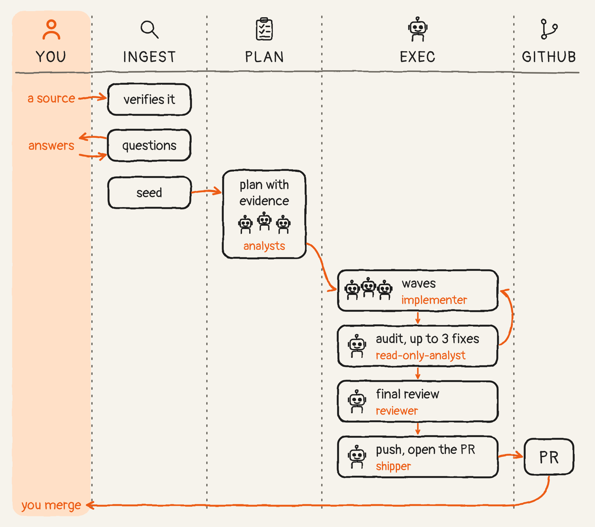
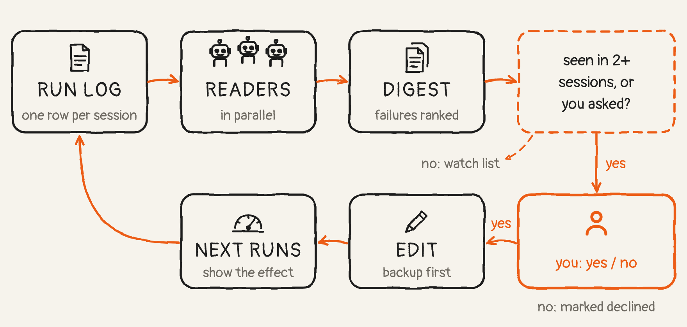

# sin-flow

**Ticket in. PR out. One shot.**

Issue, ticket, feature, hotfix. Small or big, doesn't matter. Hand it over once, answer a few questions,
and get back a pull request. A Claude Code plugin for developers on a live codebase.

## Install

```
claude plugin marketplace add SavenkoSy/sin-flow
claude plugin install sin-flow@sin-flow
```

Then, inside your repo:

```
/sin-flow:setup
```

## One shot

```
/sin-flow:ingest <issue URL | GH-N | Slack permalink | Rollbar item | "plain words" | screenshot | log>
```

Ingest reads the source in full, checks the claim against the code, measures it read-only, and tells you
what happened, the evidence, and what it would do. You answer its questions, one per turn.

Then it lets go. Plan opens in a new tab, reads every ticket, measures, writes the plan and never asks.
Exec opens in the next tab, writes the code with subagents in waves, runs your CI gates and a review,
and opens the PR without asking. You come back to a PR and a final message.

## How it works

<picture>
  <source media="(prefers-color-scheme: dark)" srcset="docs/img/cycle-dark.png">
  
</picture>

<picture>
  <source media="(prefers-color-scheme: dark)" srcset="docs/img/ticket-to-pr-dark.png">
  
</picture>

| command | what it does |
|---|---|
| `/sin-flow:setup` | installs the user layer, onboards a repo, checks all layers; `add <source>` registers a read-only data source |
| `/sin-flow:sync` | reads a GitHub Projects board, or a different tracker through a local adapter, triages it, takes a batch and hands it to plan |
| `/sin-flow:ingest` | takes one request, verifies it in code and data, ends in one of five exits |
| `/sin-flow:plan` | turns a seed into a measured plan, one block per ticket, then hands off to exec; never asks |
| `/sin-flow:exec` | executes the plan with subagents in waves, runs the gates and a review, opens the PR without asking (upstream, from your fork, for an open-source repo) |
| `/sin-flow:review` | reviews any PR (quick or thorough), sorts findings into reproduces / possible / invented, posts the high and medium reproducing ones as one review |
| `/sin-flow:learning` | reads the logged runs of every stage and proposes changes to the flow |

On a solo repo, exec waits for your "merge" and merges (squash by default, or your `merge` preference in `user.md`). On a team repo, it follows the PR through review.

## Five exits

Not every request is code. Ingest picks the exit that fits, among the ones your repo's channels enable.

| exit | when | what you get |
|---|---|---|
| plan | real work, one ticket or many | a seed handed to plan, then exec, then a PR |
| hotfix | a small, clear fix | a one-block plan straight to exec, PR without asking |
| data-fix | the code is fine, a record is wrong | a support recipe a human runs |
| answer | someone asked a question | a reply draft you post yourself |
| investigation | the cause needs writing down, not fixing | a written finding |

## Any open-source repo

Found a bug in a tool you use? Paste its GitHub URL to `/sin-flow:ingest`. You don't need a clone first.
Setup clones it into `~/dev/opensources/<name>` and adds your fork as the remote `fork`. The branch goes to
your fork, and the issue and the PR go upstream.

The project's rules win: its CONTRIBUTING, its templates, AGENTS.md and its AI policy. Maintainers see
only the issue and the PR. The plan and the measurements stay with you.

## What it won't do

- **Start from a blank repo.** It reads your history, CI and tracker to decide how to work. No history, nothing to read.
- **Work outside GitHub.** Issues, Projects boards, PRs and reviews all go through `gh`. Slack and Rollbar are read only. A board write (light, assignee, status) occurs only if its profile switch is on. A new profile has all three off.
- **Run without you at the start.** Ingest asks. Plan and exec don't.
- **Post to Slack.** It reads Slack threads when Slack is connected; replies are drafts you post.
- **Put its notes in your repo.** Seeds, plans and evidence stay in `~/.claude/sin-flow/`, never in a commit.
- **Change itself on its own.** Learning proposes; nothing is edited before your yes.

## It learns

<picture>
  <source media="(prefers-color-scheme: dark)" srcset="docs/img/learning-dark.png">
  
</picture>

Every finished session is a row in a run log. `/sin-flow:learning` reads those runs with parallel readers,
ranks what went wrong per stage, and proposes diffs. You say yes or no; a yes is applied with a backup.

You start it yourself, or the plugin does: when an exec session ends with `learning_runs` (default 10)
undigested exec runs in the log, a SessionEnd hook opens `/sin-flow:learning all` in a new tab in `learning_cwd` (default `learning_dir`), once per digest. Run it outside your product repos. Both settings live in `user.md`.

- **User mode** (marketplace install): proposals change only your `user.md` and repo profiles. Ideas for the
  plugin itself are written to `proposals-for-author.md` in your learning folder.
- **Author mode** (the plugin loaded from a git checkout you can commit to, linked with
  `ln -s <checkout> ~/.claude/skills/sin-flow`): proposals may change the plugin. Apply, then `/reload-plugins`.

## Your data

Everything of yours lives in `~/.claude/sin-flow/`:

- `user.md`: preferences
- `profiles/<key>/`: one per repo (base branch, CI gates, merge methods, tracker)
  - `tracker.adapter`: a local adapter for a tracker other than GitHub Projects. The contract is in `skills/sync/reference/adapter-contract.md`.
  - `tracker.write.light`, `tracker.write.assign`, `tracker.write.status`: switches for board writes. Each is `off` when absent.
  - `group_by`: `epic`, `milestone`, `priority`, `label` or `rules`. It sets how sync groups tickets.
- `work/<key>/<id>/`: seeds, plans, evidence, ledgers
- `reviews/`: PR reviews
- `runs.tsv`: one row per finished session
- `learning/`: digests, inbox, ledger

`work/` and `profiles/` are a local git repo that a Stop hook commits to. Nothing of yours goes into the
plugin, and updates never touch this folder.

## Reference

<details>
<summary>First run, updates, hand-off, requirements</summary>

### First run

`/sin-flow:setup` creates `~/.claude/sin-flow/`, asks for your preferences once, infers the repo's profile
(base branch, CI gates, merge methods, tracker) and asks at most three questions. Or skip it:
`/sin-flow:ingest` runs setup's onboarding itself when the repo has no profile yet.

### Updates

`claude plugin marketplace update sin-flow`, then `claude plugin update sin-flow@sin-flow`, then a new session.
Each push to `main` is a new version (the commit SHA).

### Hand-off

Ingest, sync, plan and exec start the next stage in a new terminal tab. `handoff:` in `user.md` decides how:

- `auto` (default): a tab through the adapter for the terminal you run in, or `print` when there is no adapter.
- `same-session`: continue in the current session.
- `tmux`, `cmux`, `iterm`, `ghostty`, `warp` or `orca`: that terminal's adapter, for when `auto` cannot tell where you run; setup asks and checks it with `sin-flow-handoff --check` (the command is on PATH; `tmux` and `cmux` also need a session inside them; the app is installed for `iterm`, `ghostty`, `warp`).

In Claude Desktop the setting is ignored: ingest and sync start the next stage as a Desktop session, and every later stage continues in that session. Add `"mcp__ccd_session__start_session"` to `permissions.allow`, and keep the ingest conversation on screen so Desktop can ask you to trust the new worktree.
- `print`: print the ready command and copy it to the clipboard.
- a path to your own script.

Any other work hands off the same way: `sin-flow-handoff --cwd <dir> --name <tab> --prompt "<text>"` opens a tab in `<dir>`, or in its repo root when `<dir>` is inside a git repo, that starts `claude` with that prompt.

A script gets `FLOW_CWD` (repo root), `FLOW_NAME` (tab name), `FLOW_MODEL` and `FLOW_PROMPT` (the full
`claude …` command line) in its environment. Exit 0 means the tab opened; any other code makes the flow print
the command instead. With `--probe` it prints what it would run and opens nothing.
`examples/handoff.sh.example` opens a macOS Terminal window; setup offers to copy it to
`~/.claude/sin-flow/handoff.sh`.

Shipped adapters, in `bin/handoff/`: `tmux`, `cmux`, `iterm`, `ghostty`, `warp`, `orca`. Adding a terminal is
one script there, its name in `terminals`, one line in `detect()` and one in `--check` in `bin/sin-flow-handoff`. `sin-flow-handoff --detect` names the
adapter it would use.

`context_guard` (default 40) in `user.md` is the percent of the 1M-token context window at which a stage hands off to a fresh session; setup never stops on it.

#### Models

The flow uses three tiers. The plugin ships the defaults; set any of them in `~/.claude/sin-flow/user.md`:

| key | default | used by |
|---|---|---|
| `models.strong` | `opus` | plan, exec and learning sessions, hand-offs, the review verify pass |
| `models.mid` | `sonnet` | analysts, implementers, shipper, review-poster |
| `models.cheap` | `haiku` | the board agent |
| `models.<stage>` | `models.strong` | the session a hand-off opens for that stage (`plan`, `exec`, `ingest`, …) |

Values: `opus`, `sonnet`, `haiku`, `fable`. No Opus on your account: `models.strong: sonnet`.
Fable by default: `models.strong: fable`. A repo profile may set the same keys for that repo, which helps when it
runs under another Claude account. Plan on Fable, exec on Opus: `models.strong: opus` and `models.plan: fable`.
`sin-flow-profile model strong` (or `model plan`) prints what the flow will use here.

### What's inside

Seven skills, six agents (`board`, `implementer`, `read-only-analyst`, `reviewer`, `review-poster`,
`shipper`), hooks, and three CLIs on your PATH while the plugin is enabled: `sin-flow-profile`,
`sin-flow-infer`, `sin-flow-handoff`.

### Requirements

- `git`, `gh` (logged in), `jq`, `bash`: every stage and hook.
- `node` and `npm`: optional, only for the visual check in exec (Playwright, installed on first use) and a
  browser probe in plan when a profile's measurement doc names one.
- `pbcopy`, `wl-copy` or `xclip`: optional, for the clipboard. `osascript`: the iTerm, Ghostty and example
  hand-offs on macOS.

</details>

## License

MIT. See [LICENSE](LICENSE).
